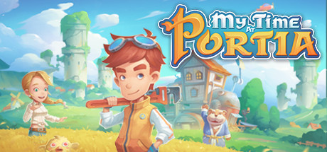

**My Time at Portia is the charming workshop simulation RPG where you restore your father's workshop in a post-apocalyptic pastoral town, building machines, fulfilling commissions, and befriending or romancing the colorful residents of Portia.**

---

## 📖 About

My Time at Portia is the charming workshop simulation RPG where you restore your father's workshop in a post-apocalyptic pastoral town, building machines, fulfilling commissions, and befriending or romancing the colorful residents of Portia.

## ⚠️ Problems Without Trainer

| Problem | Status |
|---------|--------|
| **Commission Deadlines** — Late deliveries damage reputation and lose order bonuses | ✅ Solved |
| **Stamina Scarcity** — Daily stamina limits what can be accomplished each in-game day | ✅ Solved |
| **Resource Gathering Grind** — Building large machines requires gathering specific materials over many days | ✅ Solved |
| **Relationship Scheduling** — Managing friendship and romance events requires careful daily planning | ✅ Solved |

## ✅ Solution

The **My Time at Portia Trainer** solves all these issues by giving you complete control over the game.

## 🎯 Full Feature List

- Unlimited Resources
- God Mode / Invincibility
- Instant Skill Cooldown
- One-Hit Kill
- Freeze Game Timer
- Unlock All Items & Achievements
- Custom Speed Multiplier
- Save State Anywhere

## 🚀 Quick Start

1. **Disable Windows Defender** temporarily (trainer may trigger false positive)
2. Download the trainer from the button above
3. Launch My Time at Portia
4. Run the trainer as Administrator
5. Activate desired cheats with hotkeys

## 💎 Free vs Paid

| Feature | Free | Pro |
|---------|------|-----|
| Basic God Mode | ✅ | ✅ |
| Unlimited Resources | ✅ | ✅ |
| All Advanced Cheats | ❌ | ✅ |
| Auto-Updates | ❌ | ✅ |
| Priority Support | ❌ | ✅ |

## 💻 Requirements

- Windows 10/11 (64-bit)
- My Time at Portia (any version)
- .NET Framework 4.8+
- DirectX 11+

## 🍎 macOS

macOS users can use our alternative tool:

## ⚖️ Legal

This trainer is for educational and single-player use only. Use responsibly.

---

